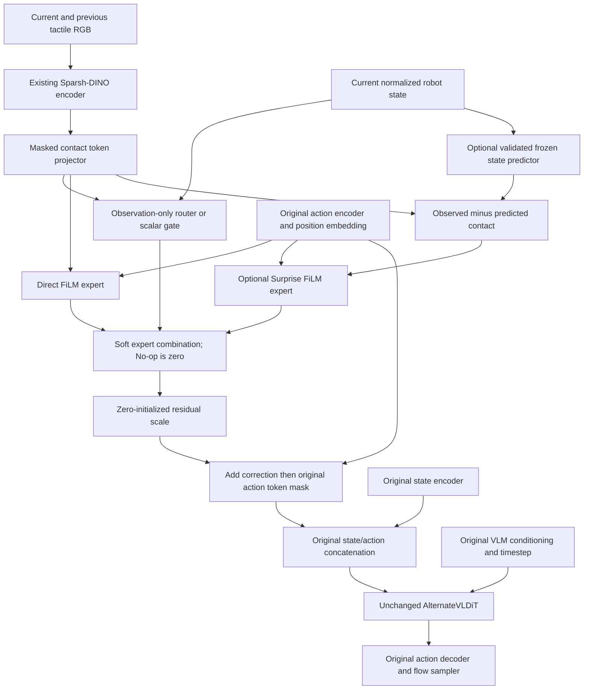

# Input-level Contact-Routed MoE

## Scope and isolation

Branch: `experiment/contact-input-moe-20261021`.
Approved base: `be334bc79f1245d8fc1b4d308f587027c732a0a8`, the immediate
parent of the committed Sidecar experiment. Worktree:
`/ssdg/spl_yeongyoo/secret-project-florence-contact-moe`.
No Sidecar or ITAM code was merged, cherry-picked, or implemented.
The original checkout and Sidecar branch were not edited.

This is an unvalidated architecture hypothesis, not a reproduction of
[ForceVLA](https://arxiv.org/abs/2505.22159),
[ForceVLA2](https://arxiv.org/abs/2603.15169), or
[LIFT](https://arxiv.org/abs/2607.14236).
ForceVLA motivates modality-dependent expert mixing; ForceVLA2 motivates
selective force conditioning; LIFT motivates preserving the pretrained policy
at initialization and distinguishing injection from reactive execution.
The [research note](https://app.notion.com/p/Cross-Attention-3ff86beeb9998007837dc8c112e52f48)
records this input-level proposal separately from Sidecar and ITAM.
No performance or novelty claim follows from implementation tests.

## Architecture and insertion point



`Gr00tN1d7ActionHead.forward` and `get_action_with_features` apply the adapter
immediately after the existing position embedding, before the original action
mask and state/action concatenation. `dit_type` remains `alternate_vl_dit`.
`gr00t/model/modules/dit.py` and `extension/multimodal_dit.py` are unchanged.
There are no new blocks, QKV replacements, sequence tokens, flow objectives,
action normalization rules, or timestep transformations inside the DiT.

The router consumes **normalized observed state**, before state dropout, and
pooled observed contact. It never accepts actions, noisy targets, sampled
trajectories, future observations, or flow timesteps. The experts may read the
current action embedding: training obtains it from the usual noised targets;
inference obtains it from the sampled trajectory. This is the original action
model's generative conditioning path, not an observation for choosing experts.

| Tensor | Shape |
|---|---|
| Encoder output | B × N × D |
| Valid tactile token mask | B × N, True means valid |
| Compact observed/predicted contact | B × K × C |
| Observed normalized state | B × history × state dimension |
| Current action embedding / each expert correction | B × H × D |
| Valid action token mask | B × H |

Defaults: K=4, C=256, D=1536. The real cached checkpoint has **32** DiT layers.
The `ContactRepresentation(observed, valid, predicted)` named tuple is the sensor-independent adapter boundary.
Masks apply to encoded sensor tokens, not physical contact labels. Empty token
sequences and all-masked rows give zero corrections without NaNs. A missing
required tactile field is an explicit input error. Sensor backends retain their
existing image/temporal preprocessing and validation.

## Equations and modes

Masked learned pooling uses K queries over projected tactile tokens:

`C = softmax(Q (W T)^T / sqrt(C_dim), valid_mask) (W T)`.

The small independent FiLM experts use:

`E(H,C) = LN(H) * tanh(W_scale mean(C)) + W_shift mean(C)`.

`E_noop = 0`, `E_direct = E_1(H,C)`,
`E_surprise = E_2(H,C - predicted_C)`.

For soft MoE, `p = softmax(R(state,mean(C)) + invalid_expert_mask)` and
`H_new = H + alpha * (p_direct E_direct + p_surprise E_surprise)`.
The final existing action mask is still applied. Invalid tactile rows make
No-op the only available expert. B3 has **two trainable logits**, not a disabled
third logit in the softmax. The returned diagnostic probability vector has a
third exact-zero entry for interface stability.

| Mode | Modules beyond projector/direct expert |
|---|---|
| none (B0) | No contact modules or tactile encoder instantiated |
| direct (B1) | Only the residual scale; no router/gate |
| scalar_gate (B2) | One sigmoid linear gate over state/contact |
| moe_soft (B3) | Small two-output MLP for No-op/Direct |
| moe_soft + Surprise (B4) | Three-output router, independent Surprise expert, validated predictor |

Soft routing evaluates the Direct expert even when No-op dominates; it provides
conditioning selection, not sparse-compute acceleration. Hard Top-1 is a future
ablation and is not enabled or implemented here. No uniform-usage penalty,
contact supervision, auxiliary prediction loss, or load-balancing objective is
added. Consequently no artificial `contact_moe_load_balance_loss` is logged.
The original masked flow-matching loss is unchanged.

`alpha` is an `nn.Parameter(torch.zeros(1))`. At initialization finite adapter
outputs yield exact forward parity. On the first backward, alpha can have a
nonzero gradient, while router/expert/projector action-loss gradients are zero.
After alpha moves, those gradients become available. Tests distinguish gradients
from actual optimizer updates. Low-precision SGD updates can round away; the
update tests use AdamW without weight decay. Use the repository's normal mixed
precision optimizer/master-weight handling for training. There is no nonzero
initialization or implicit warmup exception. HF missing-weight initialization
explicitly initializes both alpha and bare learned pooling queries.

## Sensors, predictor provenance, and checkpoints

Sparsh-DINO remains the default; ResNet and existing encoder interfaces remain
available. The sensor's pretrained backbone and newly initialized projection
are distinct: `tune_tactile_encoder` controls the backbone, while existing
`tune_multimodal_adapter` controls the Sparsh projection. All new adapter
parameters use `train_contact_input_adapter`; `train_contact_router` independently
controls the MLP/scalar gate within a trainable adapter.
`freeze_pretrained_dit` freezes the complete original DiT without placing it in
`no_grad`; activation gradients still cross its frozen blocks. VLM and original
state/action projector controls retain their original behavior.

Contact sensor projection initialization uses a fixed local seed 42 so B1–B3
start from identical sensor weights despite different router sizes. The adapter
constructor preserves the parent RNG state. The default comparison script also
sets seed 42 for data and other initialization.

No compatible trained predictor was supplied. **B4 is unavailable for real
comparisons.** A random predictor is never silently substituted. The implemented
state-only predictor is an interface for externally trained models, not a claim
that state alone predicts contact reliably. No Sidecar predictor was copied.

A predictor bundle is a `torch.save` dictionary loaded with `weights_only=True`:

```python
{
  "metadata": {
    "format": "florence-contact-state-predictor-v1",
    "num_tokens": 4,
    "contact_dim": 256,
    "encoder_sha256": "<digest from encoder_digest(exact_sensor_encoder)>",
    "training_provenance": "<dataset/split/checkpoint/training procedure>",
    "validation_report": "<held-out quality and representation-collapse audit>"
  },
  "projector": trained_contact_projector.state_dict(),
  "predictor": trained_state_predictor.state_dict()
}
```

Strict shape/key loading, encoder digest, token count, feature width, and required
provenance fields reject incompatible bundles. Metadata alone does not prove
predictive quality; the validation report must be reviewed before B4. The digest
binds encoder dtype/weights and buffers as loaded, so create the bundle with the
same sensor precision. B4 freezes the entire sensor encoder, projector, and
predictor to retain the aligned latent space. Predictor state and observed
projector are then embedded in the normal model checkpoint; persisted
`contact_predictor_embedded` lets inference reload without the external path.

The Florence loader only permits the new adapter prefix when enabling it from
a checkpoint without an adapter. Existing sensor deferred bootstrap remains
explicit. All other missing, unexpected, and mismatched keys still fail.
Resuming with a different mode/width/token count/Surprise layout fails rather
than dropping weights. Saved HF config and state contain the new architecture.
Native optimizer/scheduler/RNG resume and generic ZeRO export remain the existing
repository mechanisms; distributed resume/export were not exercised here.

The inspected UniVTAC converter, active modality contracts, and local
`univtac_full/meta/{info,modality}.json` expose tactile RGB, robot state, and
point-cloud fields; no force/torque/pressure training channel was established.
No force loader, fabricated force observations, or TaF training is introduced.
Future encoders can supply the same masked contact representation, but shared
shape alone does not establish semantic interchangeability.

## Inference, caching, and contact responsiveness

Tactile encoder outputs and compact contact/predicted contact are computed once
per observation. The small deterministic observation-only router is currently
recomputed from those fixed features on each denoising step. Each action-dependent
FiLM correction is recomputed for the current action embedding. Training and
inference call the same adapter.

The UniVTAC modality config predicts **16 valid actions**. The original model
checkpoint internally supports 40; the processor pads the remaining 24 with the
existing mask. Closed-loop `run_closed_loop_eval.py` defaults to
`--execution-horizon 1`, whereas some older diagnostic scripts default to 16.
The worker runs inference once per executed chunk and then executes each selected
joint-position action in order. It does not change an already selected action
because contact changed during that chunk.

The added tactile-only rollout path records raw unmarked RGB at reset and after
each executed action, including inside a chunk. It supplies the last two action
observations as `[-1,0]`, repeats reset RGB initially, and clears history on reset.
Multiple sensors require `GR00T_UNIVTAC_TACTILE_KEY` to select the training sensor;
`rgb_marker` is never substituted. The task requests raw RGB when the checkpoint
requires it. The existing RGB rollout remains supported; point-cloud checkpoints
remain outside this tactile-only rollout adapter.

UniVTAC data is nominally 10 Hz, giving roughly 100 ms between successive
recorded action observations. Actual simulation/hardware elapsed time, rendering,
action execution duration, and model latency were not measured. With execution
horizon h, inference reruns every h executed actions; newly recorded contact can
only affect the next inference. No control frequency or default execution horizon
was changed. This input adapter does not itself guarantee slip reactivity.

## Diagnostics and distributed behavior

Enable `--contact-input-diagnostics`. The existing Trainer/W&B logging path and
new `contact_input_diagnostics.jsonl` receive scalar summaries at the existing
50-step diagnostic cadence:

- `contact_input_injection_scale`, `contact_input_injection_scale_grad` (norm),
  `contact_input_residual_ratio`.
- `contact_router_entropy`, No-op/Direct probabilities and argmax expert usage;
  Surprise probability/usage only when Surprise is configured.
- Direct/Surprise/router/encoder gradient norms when those gradients exist.

No-op has no parameters or gradient norm. Direct mode has no router metrics.
The inspected baseline contains no Rich dashboard infrastructure, so no Sidecar
Rich implementation was imported. Trainer/W&B and JSONL are the available paths.
The residual ratio is measured on actual forward activations, and the scale is
read inside its gathered module forward, rather than from a partitioned ZeRO
parameter shard. Gradient summaries use ZeRO-3 local FP32 gradients and sum shard
squared norms across ranks; replicated norms are averaged. Host scalar reads
occur at logging, not in every adapter forward. Diagnostics are disabled by
default and do not retain activation graphs. Distributed execution still needs
a real multi-GPU validation run.

## Parameter counts and overhead

Analytical counts use the real cached checkpoint configuration, D=1536,
state width=132, K=4, C=256, and the script's freeze settings:

| Variant | Adapter parameters | Total trainable Action Head parameters |
|---|---:|---:|
| B0 | 0 | 528,793,728 |
| B1 | 1,187,073 | 531,163,521 |
| B2 | 1,187,462 | 531,163,910 |
| B3 | 1,287,171 | 531,263,619 |
| B4 | 2,377,220 total; 1,685,508 trainable | 530,479,236 |

The shared tactile encoder has 87,438,336 parameters, including 1,182,720 in its
trainable projection for B1–B3; B4 freezes that complete encoder. B4 therefore
has a representation-freezing difference that must be reported alongside the
predictor comparison. Counts exclude the frozen VLM. Changing freeze/projector
flags changes the trainable totals; the actual optimizer logs all owned groups.

B3 adds about 2.46 MiB of BF16 adapter weights. An illustrative 16 bytes per
trainable parameter for unsharded training state is about 19.6 MiB, before
activations and allocator costs. These are not measured VRAM numbers. Sparsh
encoding and original DiT backward activations dominate the small input adapter.
The new work per denoising step scales with action horizon and embedding width,
not the number of DiT layers. No latency or memory-fit guarantee is claimed.

Known risks: router collapse, noisy tactile images, sensor/background mismatch,
state-only predictor ambiguity, latent drift, BF16 update rounding, excessive
injection growth, small-data overfitting, and contact changes inside an executed
chunk. Evaluate success, held-out flow loss, action sensitivity under tactile
shuffle/noise/off, gate/residual norms, expert entropy/usage, and actual latency.
A large surprise residual can indicate sensor noise or model error as well as
unexpected physical contact. No contact/free-space labels were invented.

## Reproducible commands

Run from this worktree. It has its own uv-created Python 3.12 environment;
read-only dependency paths point to the already installed repository packages.
There is no editable package link to the original source: interpreter/import
paths were checked against this checkout. Use `uv run --no-sync` to preserve that
verified environment. A portable installation can instead use `uv sync --all-extras`
in a fresh environment and recheck imports. No dependency install is needed to
run the commands in this server environment.

```bash
cd /ssdg/spl_yeongyoo/secret-project-florence-contact-moe
uv run --no-sync python -c 'import sys, gr00t; print(sys.executable, gr00t.__file__)'
export BASE_MODEL=/absolute/path/to/original/GR00T-N1.7-checkpoint
export DATASET_PATH=/absolute/path/to/converted/contact/UniVTAC

# New target required; never rebuild or overwrite an existing subset.
uv run --no-sync python scripts/prepare_contact_overfit5.py \
  "$DATASET_PATH" "$PWD/outputs/contact_input/data/overfit5"
export DATASET_PATH="$PWD/outputs/contact_input/data/overfit5"

# Same data/split/seed/batch/accumulation/LR/steps/action mask across B0–B3.
bash scripts/train_univtac_contact_input.sh B0
bash scripts/train_univtac_contact_input.sh B1
bash scripts/train_univtac_contact_input.sh B2
bash scripts/train_univtac_contact_input.sh B3 --contact-input-diagnostics

# B4 deliberately errors until CONTACT_PREDICTOR is a reviewed valid bundle.
export CONTACT_PREDICTOR=/absolute/path/to/validated_predictor_bundle.pt
bash scripts/train_univtac_contact_input.sh B4 --contact-input-diagnostics

# Explicit same-architecture resume; retain native optimizer state.
bash scripts/train_univtac_contact_input.sh B3 \
  --resume-from-checkpoint outputs/contact_input/B3/checkpoint-100

# One-step full-pipeline smoke command for a GPU machine (NOT executed here).
bash scripts/train_univtac_contact_input.sh B3 \
  --max-steps 1 --save-steps 1 --gradient-accumulation-steps 1 \
  --output-dir outputs/contact_input/B3_gpu_smoke --contact-input-diagnostics

# Held-out flow loss; use episodes excluded from the training dataset.
export CHECKPOINT="$PWD/outputs/contact_input/B3/checkpoint-100"
export VALIDATION_DATASET=/absolute/path/to/held_out_contact_dataset
uv run --no-sync python scripts/evaluate_contact_input.py \
  --checkpoint "$CHECKPOINT" --dataset-path "$VALIDATION_DATASET" \
  --episode-ids 0 1 --steps 8 --seed 42 --device cuda \
  --conditions enabled off shuffle noise \
  --output outputs/contact_input/B3_validation.json

# Inference server; checkpoint must include the tactile processor contract.
uv run --no-sync python gr00t/eval/run_gr00t_server.py \
  --model-path "$CHECKPOINT" --embodiment-tag NEW_EMBODIMENT --port 5555

# Separate terminal, Isaac/UniVTAC Python runtime and task assets required.
export GR00T_UNIVTAC_TACTILE_KEY=tactile/left_gsmini/rgb
uv run --no-sync python examples/UniVTAC/run_closed_loop_eval.py \
  --univtac-root /absolute/path/to/UniVTAC --checkpoint "$CHECKPOINT" \
  --server-port 5555 --mode smoke --execution-horizon 1 \
  --python-command '/absolute/path/to/isaaclab.sh -p' \
  --output-dir outputs/contact_input/B3_rollout

# Existing native ZeRO export, if checkpoint weights are rank partitioned.
uv run --no-sync python scripts/export_zero3_checkpoint.py \
  /absolute/path/to/native/checkpoint-100 outputs/contact_input/B3_export \
  --model-config-dir /absolute/path/to/saved/model_config
```

The validation tool uses the saved model/processor, complete within-episode
observation/action windows, identical seeds for each condition, and the original
valid-element loss reduction. It never creates an optimizer. Off bypasses only
the adapter output; shuffle permutes real tactile samples; noise adds reproducible
pixel noise. Held-out selection remains the experimenter's responsibility.
The baseline's sharded DatasetFactory does not support Trainer evaluation sets;
this explicit offline utility avoids fabricating an `--eval` training flag.
CLI help/flag syntax is checked; full GPU training/validation/Isaac commands are
provided for manual execution, not claimed as run.

The five-episode subset was actually prepared at the path above from
`/ssdg/spl_yeongyoo/univtac_full`: episodes 0–4, 265 frames. If it already exists,
reuse it rather than repeating the preparation command. No training was started.

Recommended order: B0 loader/memorization check → B1 gradient and tactile
sensitivity check → B2 versus B3 with matched budgets → held-out loss and
closed-loop success/latency → B4 only after predictor quality/alignment review.
Do not compare B4 to B3 as a clean routing-only change without accounting for its
frozen teacher representation.

## Executed checks and remaining validation

Final targeted regression result: **132 passed** across the adapter/head/DiT,
optimizer, rollout, sensor-loading, Sparsh, dtype, horizon, model-forward,
offline evaluator, and embedded-Surprise reload suites.
Ruff, shell syntax, documented CLI help, and `git diff --check` pass.
See `contact_input_moe_validation.json` for exact commands, file manifest, and smoke results.
New tests cover zero-scale parity, unchanged original DiT parameters, Direct and
Scalar Gate shapes/gradients, No-op, available-expert normalization, disabled
Surprise, actual optimizer updates, FP32/BF16, missing/masked tokens, action masks,
train/inference application counts, action-independent routing, provenance
rejection, Florence strict loading, actual HF serialization/reload, optimizer
ownership, consistent sensor initialization, and tactile rollout histories.

Two inherited regression test harness defects were corrected in this branch:
a test method lacked `self`, and a test expected two layer-hook calls while
registering a hook on only the first layer. It now observes both layers without
weakening the dtype assertions. No original DiT implementation was edited.

The real cached GR00T **Action Head** and real Sparsh checkpoint were exercised
on CPU with BF16 autocast, synthetic observations, horizon 2 and one inference
denoising step. This is not a full VLM/processor/dataset smoke. It checks real
pretrained parameter loading, finite backward, gate update, unchanged DiT digest,
adapter-state save/reload, and inference. Real full-checkpoint HF model
serialization is represented by tiny-model tests, not a full 3B save/reload.

Not verified: full real Florence VLM/processor/data training or validation,
GPU kernels, distributed ZeRO-3 training/resume/export, Isaac closed-loop rollout,
real predictor quality, five-episode convergence, latency/VRAM, or any performance
advantage. CUDA is unavailable to this session's interpreter. No full training,
push, merge, or worktree deletion was performed.
