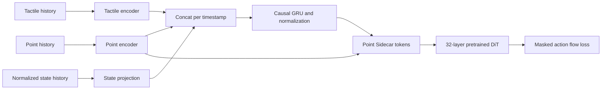
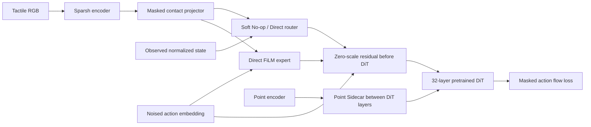

# Florence Sidecar ablation suite

All six experiments use `experiment/sidecar-ablation-suite`, the same UniVTAC five-episode subset, action normalization, action masks, and masked flow-matching objective. The Hydra configuration is saved under each run's `.hydra/config.yaml`; `output_dir` includes the run timestamp. No long jobs are launched by setup or preflight.

## Architectures





The two injection sites are independent. MoE acts on action embeddings before the DiT. Point Sidecar acts between selected original transformer blocks. The legacy contact surprise predictor and its Smooth L1 loss are disabled in all six configurations. No unvalidated surprise expert is instantiated by the selected MoE mode.

| Hydra experiment | Launcher mode | Architecture | DiT mode |
|---|---|---|---|
| `temporal_sidecar_ditfrozen-overfit5` | `temporal_frozen` | Temporal + Sidecar | frozen |
| `temporal_sidecar_ditlora-overfit5` | `A` (or `temporal_lora`) | Temporal + Sidecar | LoRA |
| `temporal_sidecar_ditfull-overfit5` | `C` (or `temporal_full`) | Temporal + Sidecar | full |
| `moe_sidecar_ditfrozen-overfit5` | `sidecar_moe_frozen` | Input MoE + Sidecar | frozen |
| `moe_sidecar_ditlora-overfit5` | `B` (or `sidecar_moe_lora`) | Input MoE + Sidecar | LoRA |
| `moe_sidecar_ditfull-overfit5` | `D` (or `sidecar_moe_full`) | Input MoE + Sidecar | full |

Each architecture family shares one base configuration. Its variants change DiT trainability only. The full variant necessarily sets `tune_diffusion_model=true` and `freeze_pretrained_dit=false`; configuration validation rejects incompatible combinations. The VLM is frozen. Original DiT parameters use 1e-5 in full mode; new modules and LoRA use 1e-4. LoRA rank 16, alpha 32, dropout 0 is the default. Set `dit_training.rank=32` for a rank-32 run.

## Checkpoint and LoRA verification

`scripts/verify_pretrained_dit.py` reads the actual checkpoint safetensors one tensor at a time. The original `AlternateVLDiT` schema supplies the expected names and shapes. Each candidate original parameter is compared with the checkpoint after an explicit cast to the candidate dtype using `torch.equal`; reports include every tensor's dtype, shape, match result, and maximum difference. New Sidecar and LoRA keys are excluded by explicit names. Missing or mismatched original keys fail. For LoRA, the script checks all original weights before insertion and again after insertion, then checks freezing and optimizer ownership. The script tests three identical seeded DiT forward inputs at timesteps 0, 127, and 999, with all residual gates initially zero. BF16 output tolerance is 2e-2 absolute and relative to allow operation-level rounding; weight comparisons require exact equality after casting. JSON and text reports default to `outputs/preflight/dit_verification.{json,txt}`.

The actual cached GR00T N1.7 checkpoint inspected here has 32 layers, 1,091,722,240 original DiT parameters and 456 original state tensors. The BF16 Action-DiT audit matched all 456 with maximum absolute difference zero. Initial output parity passed for frozen, rank-16 LoRA, and full candidates. Separate CPU audits exercised the actual training-model loader in both rank-16 LoRA and full modes, with the local official Concerto and Sparsh checkpoints and SDPA in place of GPU FlashAttention. Both matched all 456 original DiT tensors exactly and passed initial output parity; see `outputs/preflight/dit_verification_training_loader_{cpu,full_cpu}.json`. These CPU checks do **not** prove four-GPU ZeRO-3 training, the GPU VLM attention implementation, optimizer steps, or convergence. At launch, the training worker additionally compares the loaded training model's original DiT tensors against the same checkpoint on rank 0 before the first optimizer step. If tensors are already ZeRO-partitioned at this point, the worker fails instead of gathering the full model on all GPUs.

LoRA wraps only the original DiT blocks' diffusers Attention `to_q`, `to_k`, `to_v`, and `to_out[0]` linear layers. The wrapper keeps the original `weight` and `bias` checkpoint keys; it adds `lora_A` and zero-initialized `lora_B`. No VLM, projector, or Sidecar module is a LoRA target. Rank 16 adds 6,553,600 trainable DiT LoRA parameters in the inspected checkpoint. The training worker checks requires-grad flags, optimizer ownership, and parameter counts before training. The standalone preflight's one-step LoRA and full-FT update checks use **small synthetic modules**, reported separately from actual checkpoint verification.

`scripts/preflight_florence_ablations.py` validates the resolved Hydra configuration, dataset and output paths, small synthetic forward/backward/optimizer contracts, and the actual pretrained Action-DiT tensor and output check. The launcher calls it before Torchrun. A failed mandatory check prevents training. The worker performs the final training-model tensor and optimizer checks. GPU, ZeRO-3, save/resume, and convergence tests remain to be run on the target system; a CPU preflight does not mark them passed.

## Temporal data and ring buffer

The default 5-frame data config requests point and normalized state offsets `[-4,-3,-2,-1,0]`; tactile requests `[-5,-4,-3,-2,-1,0]` so Sparsh can encode the pair ending at each point/state timestamp. The 10-frame config extends these causal offsets. Dataset sampling stays inside each episode. The standard dataset's `allow_padding=false` excludes samples with insufficient history, avoiding false validity. For inference, a `[B,T]` validity mask may mark repeated boundary frames; the temporal module zeros invalid tokens and does not update its GRU state for them. The unidirectional GRU cannot read later frames. Training recomputes every encoded window with gradients, so it never reuses stale trainable features.

`LatentRingBuffer` stores detached encoded latents for fixed-weight inference. It has fixed capacity, chronological reads, a missing-history mask, independent environment IDs, wraparound, and explicit per-environment or global reset. `push` rejects tensors requiring gradients. The action head uses the cache when inference inputs provide unique `temporal_environment_ids`; `temporal_reset` must mark new episodes. The first request seeds the buffer from the full valid window, and subsequent requests encode the newest frame pair. The processor requires an explicit `temporal_valid` mask for temporal inference. Training clears any cache and recomputes differentiable windows. A deployment adapter must supply stable IDs, masks, and episode resets; the current generic server does not add these fields automatically.

## Hardware, logging, and checkpoints

The hardware default is four RTX 3090 GPUs with DeepSpeed ZeRO-3 and BF16. The suite uses one sample per GPU, eight accumulation steps and gradient checkpointing (effective batch 32) across all variants. The default `quad_3090_zero3` hardware profile keeps the optimizer on GPUs, matching the previously working ZeRO-3 path. This avoids Accelerate replacing PyTorch AdamW with `DeepSpeedCPUAdam`, whose JIT build needs a CUDA toolkit matching PyTorch's CUDA 12.8. Select `hardware=quad_3090_zero3_cpu_offload` only on a system with a compatible user-local CUDA 12.8 toolkit. Neither profile offloads parameters. Gradient accumulation is synchronized between Trainer, Accelerate's plugin and DeepSpeed without changing the effective batch.

GPU optimizer memory must be checked on the target server. For the observed frozen-mode 29,362,440 trainable action-head parameters, two FP32 Adam moments alone are about 224 MiB total, or about 56 MiB per GPU when evenly partitioned. Full tuning of the 1,091,722,240-parameter original DiT adds about 8.13 GiB of FP32 moments total, or about 2.03 GiB per GPU, before master parameters, gradients and activations. These are estimates, not a measured fit test. The full mode may need the explicit CPU-offload profile and a matching toolkit if it does not fit. Existing Rich terminal progress and noninteractive text/log-file fallback are retained. Detailed logs are saved under each output directory's `logs/`.

W&B project is `Florence`, group is `sidecar-ablation-overfit5`, and visible run name is the experiment name plus a timestamp. The resolved Hydra configuration, commit, checkpoint revision, architecture settings, optimizer groups, trainable/frozen counts, and actual DiT verification result are recorded. `pretrained_dit_verified` is set only after the actual checkpoint check; the worker refreshes it after comparing the loaded training model. Available action, gradient, feature, temporal, MoE, throughput, and GPU-memory metrics are logged; absent modules do not get synthetic zero values.

Hydra stores the complete resolved config and overrides in `.hydra/`. Native Trainer and ZeRO checkpoint saving retain optimizer, scheduler, and RNG state. Change `training.save_steps=N` for save frequency. Resume with `resume.enabled=true resume.auto_find_latest=true output_dir=/path/to/existing/run`; the existing Hydra resume validator rejects architecture, learning-rate, and optimizer changes.

## Commands

```bash
export FLORENCE_OVERFIT_DATASET=/absolute/path/to/UniVTAC_five_episode_subset
# Optional for offline machines: exact official Concerto checkpoint.
export FLORENCE_CONCERTO_CHECKPOINT=/absolute/path/to/concerto_small.pth

# Safe configuration inspection; does not load weights or start a worker.
bash scripts/train_florence_ablations.sh temporal_frozen dry_run=true

# Actual checkpoint audit on a single CPU process.
python scripts/verify_pretrained_dit.py --dit-type sidecar_conditioned_dit \
  --reference-checkpoint /absolute/path/to/GR00T-N1.7-3B --dtype bfloat16 --forward-parity

# A-D form the 2 x 2 experiment matrix. Run ONE experiment at a time.
# All modes perform mandatory pretrained-DiT preflight before starting Torchrun.
bash scripts/train_florence_ablations.sh A hardware=quad_3090_zero3  # Temporal + LoRA
bash scripts/train_florence_ablations.sh B hardware=quad_3090_zero3  # MoE + LoRA
bash scripts/train_florence_ablations.sh C hardware=quad_3090_zero3  # Temporal + Full
bash scripts/train_florence_ablations.sh D hardware=quad_3090_zero3  # MoE + Full

# Safe Hydra composition/validation only (does not load weights or start GPUs).
bash scripts/train_florence_ablations.sh A dry_run=true
bash scripts/train_florence_ablations.sh D dry_run=true

# Optional frozen-DiT control experiments (still supported).
bash scripts/train_florence_ablations.sh temporal_frozen hardware=quad_3090_zero3
bash scripts/train_florence_ablations.sh sidecar_moe_frozen hardware=quad_3090_zero3

# Ten-frame temporal variant (both the window and synchronized data offsets).
bash scripts/train_florence_ablations.sh temporal_frozen \
  data=univtac_temporal10 temporal.window_size=10

# Local CPU contract and compatibility tests.
python -m pytest tests/gr00t/model/test_florence_ablations.py \
  tests/gr00t/model/test_sidecar_dit.py tests/gr00t/model/test_dit_integrity.py -q
```

## Known limits

The real Action-DiT checkpoint and initial output checks do not establish that four-GPU ZeRO-3 training, resuming, or saving works. The runtime training-model comparison and optimizer audit have not yet been exercised on four GPUs. The 5-episode study can establish memorization behavior, not generalization. The streaming ring buffer needs explicit environment IDs, validity masks, and episode reset wiring from a deployment environment. The reference MoE branch includes an optional surprise predictor, but this suite disables it because no validated predictor bundle is available. No performance advantage is claimed before measured training and held-out evaluation.
