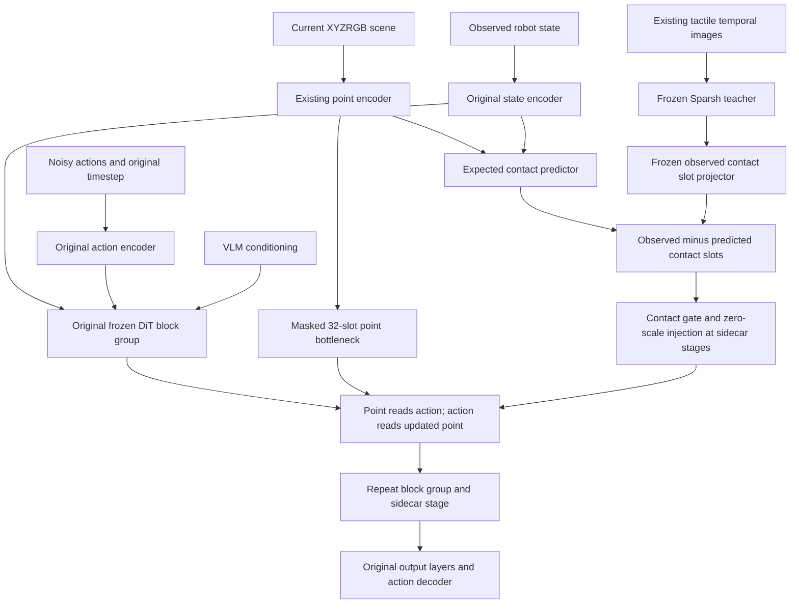

# Evolving Point–Action Sidecar and Contact Surprise

This is an opt-in Florence research architecture, inspired by repeated PointACT point/action interaction. It is not a reproduction of PointACT, PoCoDP3, FeelWorld, or ZeroTouch. Contact Surprise is a hypothesis, **not a demonstrated improvement over direct tactile conditioning**. No full training or robot experiment was performed for this implementation.

## Existing paths and compatibility

`gr00t/model/modules/dit.py` owns the original AlternateVLDiT. The existing
`extension/multimodal_dit.py` adds shared modality attention after every original
block. Neither implementation was edited for this task. `Gr00tN1d7ActionHead`
owns state/action encoders, sensor encoders, masked flow matching, and iterative
Euler inference. `setup.py` validates pretrained loading and bootstraps new
sensor encoders. These paths now recognize `sidecar_conditioned_dit` explicitly;
legacy defaults remain unchanged.

Compatibility risks are checkpoint architecture overrides, action-dependent
sensor caching, frozen-module activation gradients, and ZeRO parameter shards.
The new modules retain original parameter names, reject incompatible adapter
layouts, keep evolving representations local to each forward, and run frozen
blocks with autograd enabled. Diagnostics reuse the existing safe full gate
access and local gradient shard statistics.

## Architecture and equations



For depth L and stage count K, boundaries are zero-based
`ceil((i+1)*L/min(K,L))-1`. Depth 32 yields `[7,15,23,31]`, depth 16 yields
`[3,7,11,15]`. Explicit indices must be sorted, unique and within the resolved
checkpoint depth. Each stage owns independent projections, attention, norms,
and scalar gates; neither direction shares attention parameters.

Let H be the current action suffix and P the current compact point tokens.
With A = LN(W_a H), stage i computes:

- `dP = Attention_i_point(LN(P), A, A)`
- `P_next = mask_P * (P + point_gate_i * dP)`
- `dH = W_out Attention_i_action(A, LN(P_next), LN(P_next))`
- `H_next = H + action_gate_i * dH`

Point gates start at one; action gates start at exactly zero. Missing point rows
produce zero action updates, including projection bias. Action padding cannot
influence point attention, and padded action outputs are zeroed. Learned pooling
uses only valid point K/V tokens. All-masked rows temporarily expose a zero
attention token and discard its update. Existing encoder geometry is retained
in pooled features; learned pooling does not guarantee exact spatial recovery.

For contact slot i:

- `O_i = frozen_projector_slot_i(tactile_features)`
- `E_i = MLP(scene_pool_slot_i(point_features) + W_state observed_state_features)`
- `S_i = O_i - E_i`
- `G_i = sigmoid(Linear(concat(O_i,E_i)))`
- `L_contact = masked_mean(SmoothL1(E.float(), stopgrad(O).float()))`

The predictor's ordered slot i is trained to match observed projector query slot
i. Both tensors have exactly the same shape. There is no subtraction between
unrelated patch layouts. The gate reads observed and predicted features, rather
than only residual magnitude. It is weakly trained through action loss; no
contact labels or slip labels are invented.

At each selected stage, contact attention runs at contact width and projects
back to DiT width. `H += zero_initialized_scale * contact_update`. For
`contact_gate` and `surprise`, G weights contact tokens before attention;
this is token gating, not a supervised physical contact probability. All-invalid
tactile masks yield zero injection and zero prediction loss. Absence of physical
contact with valid images remains a learned behavior, not a known contact label.

`L_total = L_original_masked_flow_matching + weight * L_contact`.
Warmup replaces total loss with `weight * L_contact` and freezes everything except
scene pooling, state projection, and the expected-contact MLP. The flow-matching
action loss, action dimensions, masks, timestep buckets, and decoder are unchanged.
Prediction loss is reduced in FP32 independently of action padding.

Main shapes:

| Tensor | Shape |
|---|---|
| Encoder points | B × N_points × D_dit |
| Bottleneck / evolving P | B × 32 × 256 |
| Action suffix H | B × horizon × D_dit |
| Observed state features | B × N_state × D_dit |
| Sparsh features | B × N_tactile × D_dit |
| O, E, S, G | B × 4 × 256 |
| Hybrid contact sequence | B × 8 × 256 |

## Freezing, gradients, and caching

`freeze_pretrained_dit=true` freezes every original DiT parameter. It does not
use `no_grad` around the backbone: activation gradients must cross subsequent
frozen blocks. The supplied Sidecar YAML also freezes VLM, original state/action
projectors, VLM norm, and sensor backbones by default. Existing sensor projection
ownership follows `tune_multimodal_adapter`. `freeze_contact_teacher=true` additionally
freezes the complete tactile encoder and observed contact projector. Disabling
it allows the action objective to train observed representations; prediction
targets are still detached. That option can permit teacher drift: detachment
alone does not prove collapse is impossible.

At zero action gates, exact forward parity is tested in eval mode. Gate gradients
can be nonzero then, while attention gradients from action loss are initially
zero. After gates move, point attention and encoder gradients become available.
Frozen pretrained parameter equality, initial output equality, and behavior after
training are distinct. Trained residuals intentionally change downstream frozen
block activations; preserved parameter values do not imply behavioral preservation.

Sensor encoders run once per observation during inference, as before. Compact
point initialization, bidirectional evolution, and contact prediction are recomputed
for every noisy-action forward. No action-dependent point representation is cached.
Contact prediction is independent of sampled flow noise; recomputing it is redundant
but correct. Frozen teacher eval mode avoids dropout-dependent training targets.

## Dataset and leakage boundary

The checked-out `gr00t/data/dataset/univtac_dataset.py` is empty. Active contracts
are `examples/UniVTAC/univtac_config_common.py`, its converter, processor, and
closed-loop rollout implementation. The multimodal configuration supplies current
scene XYZRGB points, current robot joint state, head/wrist RGB, and tactile RGB
at temporal offsets `[-1,0]`. The predictor consumes only encoded scene points
and state before training-time state dropout. Its API accepts neither actions,
noisy action tokens, flow timestep, nor target velocities. Previous executed
actions and aligned contact/force/pressure labels are not established by this
contract, so they are not consumed or fabricated. No contact-vs-no-contact label
analysis or supervised auxiliary contact loss is implemented.

Training and rollout must both provide the existing point/tactile observation
fields. Existing conversion and rollout paths are preserved. No previous-action
fallback is substituted for missing observations.

## Configuration

Legacy CLI fields are exposed through `launch_finetune.py`; Hydra uses
`model=gr00t_sidecar`. New model fields are:

| Field | Default |
|---|---|
| dit_type | legacy default unchanged; opt in to sidecar_conditioned_dit |
| sidecar_num_stages / sidecar_stage_indices | 4 / null |
| sidecar_hidden_dim / sidecar_num_heads | 256 / 4 |
| sidecar_num_point_tokens | 32 |
| tactile_fusion_mode | surprise (only affects sidecar) |
| contact_num_tokens / contact_hidden_dim | 4 / 256 |
| contact_prediction_loss_weight | 0.1 |
| freeze_pretrained_dit / freeze_contact_teacher | true / true |
| contact_injection_enabled | true |
| contact_predictor_warmup | false |

`tune_point_encoder`, `tune_tactile_encoder`, and `tune_multimodal_adapter` remain
available. Warmup overrides these to train only the predictor inputs and MLP.
Stage C initializes the predictor using the **full Stage B model checkpoint**;
there is no separate predictor-only checkpoint importer. Resume uses existing
native optimizer/scheduler/RNG checkpoint support. Sidecar architecture dimensions
and stage layouts must match on reload. Fusion mode and training-stage flags may
change intentionally between stages.

New parameters belong to the action-head optimizer group, with existing
weight-decay rules and separate sensor-backbone learning rates. Existing ownership
validation rejects duplicate or unclassified trainable parameters. Actual total
and trainable counts are logged per new module, including `ds_numel` under ZeRO.

## Reproducible commands

Run from the repository root with its existing uv environment. Set paths to your
converted dataset and locally available model, or use the existing Hub loader.
No commands below have run real training in this environment.

```bash
export FLORENCE_DATASET=/absolute/path/to/converted_univtac
export FLORENCE_OVERFIT_DATASET="$PWD/data/univtac_overfit5"
export BASE_MODEL=/absolute/path/to/GR00T-N1.7-checkpoint

# Configuration-only validation; does not load checkpoints.
bash scripts/train_univtac_sidecar.sh C dry_run=true

# Stage A: only point/action sidecar (optionally tune point backbone).
bash scripts/train_univtac_sidecar.sh A \
  model.base_model_path="$BASE_MODEL" hardware.gradient_checkpointing=true \
  training.max_steps=100 training.save_steps=100 name=sidecar_A

# Stage B: fixed tactile teacher; expected contact prediction only.
# BASE_MODEL may also be a saved Stage A checkpoint.
bash scripts/train_univtac_sidecar.sh B \
  model.base_model_path="$BASE_MODEL" hardware.gradient_checkpointing=true \
  training.max_steps=100 training.save_steps=100 name=sidecar_B

# Stage C: exported HF weights from Stage B, fresh optimizer for joint stage.
export STAGE_B_CHECKPOINT=/absolute/path/to/stage_B/checkpoint-100
bash scripts/train_univtac_sidecar.sh C \
  model.base_model_path="$STAGE_B_CHECKPOINT" hardware.gradient_checkpointing=true \
  training.max_steps=100 training.save_steps=100 name=sidecar_C

# Five-episode subset: independent metadata and symlinks; source unchanged.
uv run python scripts/univtac_overfit_workflow.py prepare \
  --source "$FLORENCE_DATASET" --target "$FLORENCE_OVERFIT_DATASET"
# Five-episode overfit experiment (requested runnable command; NOT executed).
bash scripts/train_univtac_sidecar.sh overfit5 \
  model.base_model_path="$BASE_MODEL" hardware.gradient_checkpointing=true \
  training.max_steps=5000 training.save_steps=100 name=sidecar_overfit5

# Real one-step smoke commands, separately for point-only and surprise.
bash scripts/train_univtac_sidecar.sh A model.base_model_path="$BASE_MODEL" \
  training.max_steps=1 training.save_steps=1 training.logging_steps=1 \
  training.gradient_accumulation_steps=1 hardware.gradient_checkpointing=true
bash scripts/train_univtac_sidecar.sh C model.base_model_path="$BASE_MODEL" \
  training.max_steps=1 training.save_steps=1 training.logging_steps=1 \
  training.gradient_accumulation_steps=1 hardware.gradient_checkpointing=true
```

Inspect `configs/data/univtac_rgb.yaml` for the dataset environment interpolation
used by both data configurations. Native ZeRO checkpoints may require the existing
`uv run python scripts/export_zero3_checkpoint.py --help` export workflow before
using them as a fresh model initialization or in rollout. To resume the same stage,
use `resume.enabled=true resume.checkpoint_path=/absolute/path/to/checkpoint-N`;
keep the matching architecture and stage flags. The existing rollout/server loads
saved model configuration, so no new inference entry point is needed.

A real pretrained weight/parity audit is runnable independently of the VLM:

```bash
uv run python scripts/verify_pretrained_dit.py \
  --reference-checkpoint "$BASE_MODEL" --dit-type sidecar_conditioned_dit \
  --forward-parity --device cuda --dtype bfloat16 \
  --report outputs/sidecar_pretrained_audit.json
```

The audit reports sensor integration as skipped in DiT-only mode. For the full
training loader use its existing `--training-config` option with the resolved
repository Config YAML. No toy test substitutes for this real checkpoint audit.

## Ablations

Use identical source initialization, seed, dataset, budget, hardware and optimizer
overrides for each comparison. Do not initialize A5 from a trained A3 while
claiming equal initialization.

| Experiment | Hydra model | Tactile override |
|---|---|---|
| A0 | gr00t_base | original RGB data configuration |
| A1 | gr00t_multimodal | existing direct per-block injection |
| A2 | gr00t_sidecar | tactile_fusion_mode=none; use_tactile_conditioning=false |
| A3 | gr00t_sidecar | tactile_fusion_mode=direct |
| A4 | gr00t_sidecar | tactile_fusion_mode=contact_gate |
| A5 | gr00t_sidecar | tactile_fusion_mode=surprise |
| A6 | gr00t_sidecar | tactile_fusion_mode=hybrid |

For example, the Stage C launcher accepts `model.tactile_fusion_mode=direct`.
Disable auxiliary contact prediction with `model.contact_prediction_loss_weight=0`
for a pure direct baseline. Direct uses compact observed contact tokens, while A1
retains its original full tactile token conditioning. This is an architectural
ablation difference to report, not an assumption of superiority.

## Diagnostics and memory

Enable `training.enable_multimodal_diagnostics=true` and optionally
`training.multimodal_diagnostics_level=per_layer`. Existing JSONL, Trainer/W&B,
and Rich dashboard paths receive sidecar gate magnitudes/gradient norms,
point/action residual ratios per stage, sidecar/encoder/predictor gradient norms,
contact prediction loss, observed/predicted variance, surprise norm, contact gate
mean, and per-stage contact injection ratios. Full gate reads use ZeRO gathering;
gradient norms use the existing safe local-shard reductions. Activation/latent
statistics are local batch measurements; they are not global contact-label metrics.
Diagnostics are disabled by default and do not retain autograd graphs. An all-zero
variance is a warning sign, not a proof of successful prediction.

For an illustrative D_dit=1536, 16-layer configuration, defaults add 12,119,308
parameters (point pool 664,832; stages 5,264,392; contact adapter 1,972,224;
contact injections 4,217,860). This is about 23.1 MiB of BF16 weights; an unsharded
16-byte-per-trainable-parameter budget would be about 185 MiB before activations.
Frozen teacher and disabled branches reduce optimizer memory. These are analytical
counts from a meta-device model, not a measured training peak.

Adapter memory scales with stages, not original depth. Evolving point activations
use B×32×256 values per stage; original frozen blocks still need activations to
propagate sidecar gradients. Attention operates at width 256 and uses SDPA through
the existing modality helper. Parameter memory is approximately 2 bytes/parameter
for BF16 weights, plus gradients, FP32 optimizer/master state and allocator costs.
Concerto/Sparsh and the VLM can dominate memory. Use batch one per GPU, gradient
accumulation, block gradient checkpointing, and existing ZeRO-3/offload controls.
There is **no measured 3090 peak-memory result or fit guarantee** from this run.

## Validation and limitations

The lightweight suite checks dynamic boundaries, exact float32 zero-gate parity,
original parameter equality, masked/all-masked inputs, bidirectional evolution,
gradients through frozen checkpointed blocks, contact alignment/subtraction,
detached targets, gate gradients, all fusion modes, BF16 backward, optimizer/model
serialization, prediction repeatability, and synthetic action-head training and
iterative inference. Existing original/multimodal, mask, checkpoint-integrity,
Hydra and instrumentation tests are also run. See the implementation report in the
final task response for the exact final test counts.

Not verified: real NVIDIA checkpoint initialization, real Concerto/Sparsh checkpoint
training, GPU BF16, distributed ZeRO-3, native distributed resume, closed-loop
UniVTAC execution, convergence, five-episode memorization, and peak VRAM. The GPU
driver is unavailable in this environment. Latent collapse remains an empirical
risk even with a frozen teacher; evaluate feature variance and contact/no-contact
behavior using valid future annotations. No supervised contact auxiliary objective,
ITAM Failure Memory, Action Risk Prediction, or Residual RL is implemented.

## Files changed for this task

Added:

- `gr00t/model/extension/point_action_sidecar.py`
- `gr00t/model/extension/contact_surprise.py`
- `gr00t/model/extension/sidecar_dit.py`
- `configs/model/gr00t_sidecar.yaml`
- `scripts/train_univtac_sidecar.sh`
- `tests/gr00t/model/test_sidecar_dit.py`
- `docs/point_action_sidecar_contact_surprise.md`

Modified (some already contained unrelated, uncommitted work):

- `gr00t/configs/model/gr00t_n1d7.py`
- `gr00t/configs/finetune_config.py`
- `gr00t/configs/hydra_config.py`
- `gr00t/experiment/launch_finetune.py`
- `gr00t/experiment/multimodal_diagnostics.py`
- `gr00t/experiment/training_dashboard.py`
- `gr00t/model/gr00t_n1d7/gr00t_n1d7.py`
- `gr00t/model/gr00t_n1d7/setup.py`
- `gr00t/model/gr00t_n1d7/sensor_loading.py`
- `gr00t/model/gr00t_n1d7/dit_integrity.py`
- `scripts/verify_pretrained_dit.py`

The original DiT source, existing multimodal DiT source and existing training
scripts were not edited by this task. Existing uncommitted workspace changes
remain present.

Final validation commands:

```bash
.venv/bin/python -m pytest \
  tests/gr00t/model/test_sidecar_dit.py \
  tests/gr00t/model/test_action_head.py \
  tests/gr00t/model/test_multimodal_dit.py \
  tests/gr00t/model/test_dit_padding_mask.py \
  tests/gr00t/model/test_dit_integrity.py \
  tests/gr00t/configs/test_hydra_config.py \
  tests/gr00t/experiment/test_multimodal_instrumentation.py \
  tests/gr00t/experiment/test_training_memory.py -q --disable-warnings
```

Result: **136 passed, 1 skipped**. The skipped real-checkpoint test requires
`GR00T_DIT_INTEGRATION_CHECKPOINT`. The sidecar file contributes 19 passing cases.
CPU BF16 and float32 zero-gate parity are exact in deterministic tests. Ruff checks,
formatting, shell syntax, `git diff --check`, and Hydra dry runs for full sidecar
and five-episode point-only configurations pass. Full pre-commit and the entire
repository test suite were not run. No claim of real training convergence follows
from these results.
